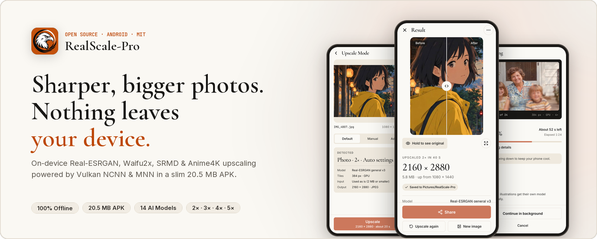
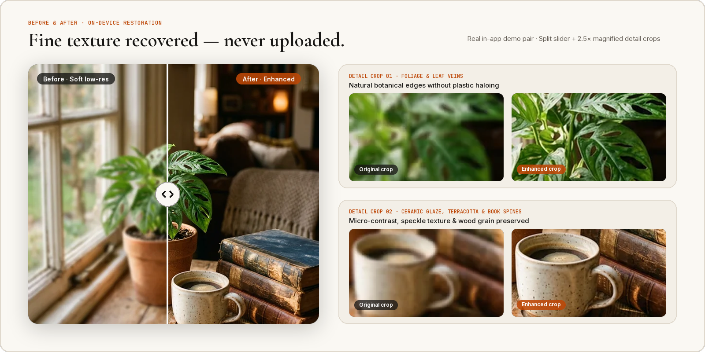
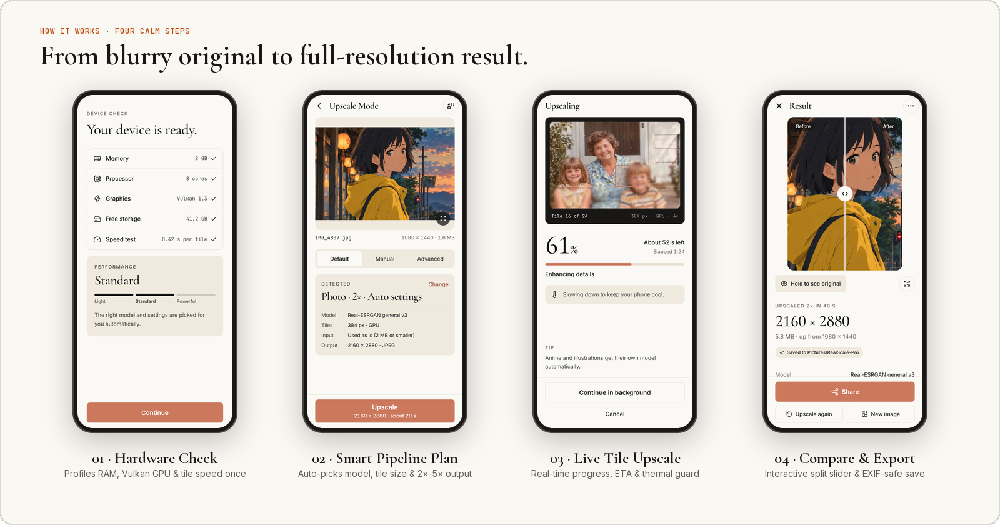
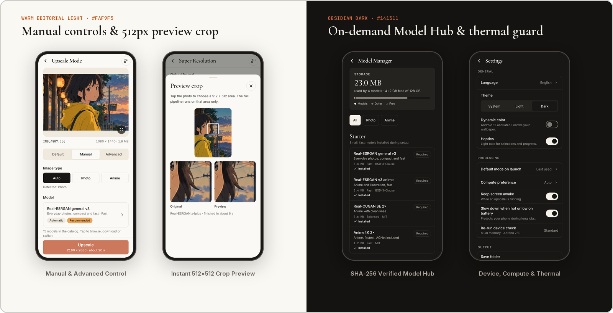

<!--
  RealScale-Pro (com.realscale.pro): free, open-source, offline AI image upscaler for Android.
  Upscale photos, scans, screenshots, anime, illustrations, and animated GIFs 2x, 3x, 4x, and 5x
  directly on device using Real-ESRGAN, RealSR DF2K, Remacri, UltraSharp, Waifu2x, SRMD, and Anime4K
  on Tencent ncnn (Vulkan GPU) and Alibaba MNN. 20.5 MB APK, 14 SHA-256 verified models, zero cloud uploads, MIT license.
-->

<p align="center">
  <picture>
    <source media="(prefers-color-scheme: dark)" srcset="assets/readme/hero-banner-dark.png" />
    <source media="(prefers-color-scheme: light)" srcset="assets/readme/hero-banner.png" />
    
  </picture>
</p>

<h1 align="center">RealScale-Pro</h1>

<p align="center">
  <b>Free, open-source, on-device AI image upscaler for Android.</b><br />
  Enlarge and restore photos, anime, and scans at 2×–5× using Vulkan GPU — no cloud uploads, no account, no ads, no watermarks.
</p>

<p align="center">
  <a href="#download--install">Download APK</a> ·
  <a href="#before--after-results">Results</a> ·
  <a href="#how-to-use">How to Use</a> ·
  <a href="#features">Features</a> ·
  <a href="#supported-ai-models">Models (14)</a> ·
  <a href="#why-realscale-pro">Comparison</a> ·
  <a href="#build-from-source">Build</a> ·
  <a href="#faq">FAQ</a> ·
  <a href="README_CHS.md">简体中文</a>
</p>

<p align="center">
  <a href="https://github.com/Rohitjjn/RealScale-Pro/releases/latest"></a>
  <a href="https://github.com/Rohitjjn/RealScale-Pro/releases/latest"></a>
  <a href="https://github.com/Rohitjjn/RealScale-Pro/actions/workflows/build-apk.yml"></a>
  <a href="LICENSE"></a>
  
  
  <a href="PRIVACY.md"></a>
  <a href="https://github.com/Rohitjjn/RealScale-Pro/stargazers"></a>
</p>

---

**RealScale-Pro** (`com.realscale.pro`) is a free, open-source Android app for offline AI super-resolution and photo restoration. It runs [Real-ESRGAN](https://github.com/xinntao/Real-ESRGAN), [RealSR](https://github.com/nihui/realsr-ncnn-vulkan), [Waifu2x](https://github.com/nihui/waifu2x-ncnn-vulkan), [SRMD](https://github.com/nihui/srmd-ncnn-vulkan), and [Anime4K](https://github.com/TianZerL/Anime4KCPP) locally on your phone's GPU via [Tencent ncnn](https://github.com/Tencent/ncnn) (Vulkan) and [Alibaba MNN](https://github.com/alibaba/MNN) (OpenCL/Vulkan), packaged inside a **20.5 MB** Jetpack Compose APK.

Built on the native engine ecosystem of [`tumuyan/RealSR-NCNN-Android`](https://github.com/tumuyan/RealSR-NCNN-Android), RealScale-Pro replaces the 475 MB monolithic bundle and command-line controls with a hardware-aware pipeline planner, an on-demand SHA-256 verified Model Manager, system-wide Share and Open-with upscaling, and a calm warm-editorial interface anyone can use in three taps.

- **Zero uploads, zero telemetry.** Every pixel stays on your phone. Once a model is downloaded, upscaling runs in airplane mode with no account, no paywall, no watermark, and no analytics SDK.
- **20.5 MB APK — 95% smaller than upstream.** All 8 native CLI engines ship solid-compressed (`binaries.tar.xz`), while AI model weights (`2.4 MB` to `33.6 MB`) download on demand over HTTPS with HTTP `Range` pause/resume and full SHA-256 checksum verification.
- **14 verified models for photos and anime.** Starts with a 7.9 MB two-model Starter Pack (*Real-ESRGAN General v3* + *Waifu2x Anime*) and scales up to *Remacri x4*, *UltraSharp x4*, *UltraMix Balanced*, *Nomos8kSC*, *RealSR DF2K*, *SRMD*, *Waifu2x CUnet*, *AnimeSharp x4*, and *RealESRGAN Anime 6B (MNN)*.
- **Exact 2×, 3×, 4×, and 5× output.** Runs each neural network at its native trained factor, then applies a single Lanczos (`avir-lancir`) pass when needed so the saved image matches the planned resolution to the pixel.
- **Built for real mobile hardware.** Profiles RAM, CPU cores, and GPU on first launch, guards against out-of-memory tiles up to `16,384 px`, automatically throttles tiles and threads when your phone runs hot or low on battery, and preserves camera EXIF metadata on export.

---

## Before & After Results

<p align="center">
  
</p>

> **Note on results:** The split image above uses the exact text-free before/after pair bundled in RealScale-Pro's interactive onboarding slider (`res/drawable-nodpi/demo_before.webp` and `demo_after.webp`), shown at identical framing with 2.5× magnified detail crops. Actual restoration sharpness and processing speed depend on your input compression, chosen model, scale factor, and phone GPU. Use the built-in **512×512 Preview Crop** tool to test any model on your own photo in a few seconds before running the full upscale.

| Input Type | Recommended Model | Engine | Typical Gain |
| --- | --- | --- | --- |
| Everyday phone photos & portraits | **Real-ESRGAN General v3** (2.4 MB, Starter) | `realsr-ncnn` | Fast 2×–4× sharpening on any arm64 phone |
| Landscapes, foliage & fine fabric | **Remacri x4** (33.6 MB) or **RealSR DF2K** (33.5 MB) | `realsr-ncnn` | High-detail texture recovery in Super Resolution Mode |
| Screenshots, UI & crisp typography | **UltraSharp x4 (fp16)** (33.6 MB) | `realsr-ncnn` | Clean edge reconstruction without ringing |
| WhatsApp / social compressed JPEGs | **RealSR DF2K JPEG** (33.5 MB) or **SRMD** (18.4 MB) | `realsr-ncnn` / `srmd-ncnn` | Removes 8×8 block artifacts while scaling 2×–4× |
| Anime, manga, comics & digital art | **Waifu2x Anime** (5.5 MB, Starter) or **AnimeSharp x4** (33.5 MB) | `waifu2x-ncnn` / `realsr-ncnn` | Crisp ink lines, flat cel shading, tunable denoise |

---

## Download & Install

### Option 1 — GitHub Releases (Recommended)

Download the latest signed `arm64-v8a` APK directly from [**GitHub Releases**](https://github.com/Rohitjjn/RealScale-Pro/releases/latest):

- **Latest Release (`v2.3.1`):** [`RealScale-Pro-v2.3.1-arm64.apk`](https://github.com/Rohitjjn/RealScale-Pro/releases/download/v2.3.1/RealScale-Pro-v2.3.1-arm64.apk) (`20.50 MiB`)
- **SHA-256 Checksum:** [`RealScale-Pro-v2.3.1-arm64.apk.sha256`](https://github.com/Rohitjjn/RealScale-Pro/releases/download/v2.3.1/RealScale-Pro-v2.3.1-arm64.apk.sha256)

```bash
# Optional: verify your downloaded APK checksum
sha256sum -c RealScale-Pro-v2.3.1-arm64.apk.sha256
```

Every official release is signed with a single stable update certificate so new releases install cleanly over earlier versions without losing your downloaded models or library:

```text
Signing certificate SHA-256:
45:C3:D0:AA:1E:31:53:AC:4C:C6:18:54:36:EB:9C:1C:F0:5C:18:2B:D1:7A:78:CE:5D:07:83:9E:3B:F8:C7:BD
```

### Option 2 — Automatic Updates via Obtainium

Track GitHub releases and get one-tap updates without Google Play using [Obtainium](https://github.com/ImranR98/Obtainium):

1. Open **Obtainium** → **Add App**.
2. Paste `https://github.com/Rohitjjn/RealScale-Pro` and tap **Add**.
3. Enable checksum or certificate pinning if desired.

### System Requirements

| Requirement | Minimum | Recommended |
| --- | --- | --- |
| **Android Version** | Android 7.0 Nougat (API 24) | Android 11+ (API 30+) |
| **CPU Architecture** | 64-bit ARM (`arm64-v8a`) | 8-core `arm64-v8a` SoC |
| **GPU** | Vulkan 1.1 or OpenCL (CPU fallback included) | Adreno 640+, Mali-G77+, Xclipse, or Tensor GPU |
| **Memory (RAM)** | 4 GB (*Light* tier, 128 px Safe tiles) | 8 GB+ (*Standard* / *Powerful* tier, 256–384 px tiles) |
| **Free Storage** | ~150 MB (app + extracted engines + Starter Pack) | 500 MB+ for heavy 33 MB Super Resolution models |

---

## How to Use

<p align="center">
  
</p>

1. **Complete the 30-second first-run setup.** RealScale-Pro checks your device's RAM, processor cores, and Vulkan GPU tier (*Light*, *Standard*, or *Powerful*), then downloads the **7.9 MB Starter Pack** (*Real-ESRGAN General v3* for photos + *Waifu2x Anime* for illustrations). You can pause and resume at any byte.
2. **Pick an image from anywhere.**
   - Tap **Gallery** (system photo picker — zero broad storage permission required on Android 13+), **Files** (any folder, SD card, or cloud drive), or **Camera** on Home.
   - Or select **Share → RealScale-Pro** or **Open with → RealScale-Pro** inside Google Photos, Samsung Gallery, or any file manager to open the translucent **Quick Upscale Sheet** directly over your current app.
   - Or drop the **Enhance** widget on your home screen and tap **2×**, **3×**, or **5×** to pick and upscale in one motion.
3. **Choose a mode and preview before committing.**
   - **Upscale Mode** optimizes speed and memory for everyday photos on any device.
   - **Super Resolution Mode** keeps the uncompressed original and runs high-capacity 33 MB models (*Remacri*, *UltraSharp*, *AnimeSharp*, *DF2K*).
   - Switch between **Default** (automatic photo/anime detection + optimal tile plan), **Manual** (pick model, scale `2× / 3× / 4× / 5×`, output format), and **Advanced** (tile size `128 / 256 / 384 px / Custom`, GPU/CPU toggle, threads, denoise strength, **TTA `-x`** quality boost, input compression policy, JPEG/WebP quality, EXIF preservation).
   - Tap the top-right **Preview Crop** button to run the exact pipeline on a `512×512` region in seconds.
4. **Upscale in the foreground or background, then compare.** Watch live tiles resolve from monochrome to full color with a rolling ETA, or tap **Continue in background** — a floating job card and silent progress notification keep you one tap away. When finished, drag the **Before / After** split slider, open the **Full screen** OOM-safe region zoom viewer, and share or find your file in `Pictures/RealScale-Pro` (or your custom folder).

For advanced tips, batch upscaling, animated GIF workflows, and troubleshooting, read the full [**User Guide (`docs/USER_GUIDE.md`)**](docs/USER_GUIDE.md).

---

## Features

<p align="center">
  
</p>

### Smart On-Device Pipeline
- **Automatic content classification** detects photos vs. anime/line-art in under 30 ms and selects the matching model family.
- **Deterministic `PipelinePlanner`** estimates output dimensions, tile count, memory usage, and completion time before you tap *Upscale*, warning ahead of time when an image exceeds safe limits — with one-tap remedies (*Switch to 2×*, *Safe tile 128 px*, *Use CPU*).
- **Sequential job queue** runs one Vulkan/OpenCL job at a time while queuing additional batch images cleanly so parallel GPU allocations never crash the driver.
- **Thermal & battery guard (`ThermalGuard`)** listens to Android thermal status and battery broadcasts, automatically reducing tile size and thread count on long runs to prevent overheating.

### Quality & Format Control
- **512×512 Preview Crop** runs your exact model and parameters on a tapped detail patch before spending a minute on a 12 MP photo.
- **Test-Time Augmentation (TTA)** wires the native `-x` 8-way ensemble pass for `realsr-ncnn`, `waifu2x-ncnn`, `srmd-ncnn`, and `realcugan-ncnn` when maximum fidelity matters more than speed.
- **Broad format & metadata support** handles PNG, JPEG, WebP, BMP, HEIF/AVIF, multi-image batches, and multi-frame animated GIFs (via bundled ImageMagick), saving to `Pictures/RealScale-Pro` or any user-selected SAF folder with optional **EXIF metadata preservation** (date, camera, lens, exposure, GPS).
- **OOM-safe full-screen zoom (`BitmapRegionDecoder`)** renders crisp 1:1 pixel tiles when pinching into 48–64 MP results without exhausting app heap memory.

### Native Android Integration & Design
- **System-wide `Open with` & `Share` Quick Sheet** upscales photos directly over your gallery app without breaking context.
- **Two Jetpack Glance home-screen widgets**: *Enhance* (with instant `2× / 3× / 5×` action chips) and *Recent creations*.
- **Three distinct notification channels**: silent live progress with **Cancel**, silent background keep-alive, and `BigPictureStyle` completion alerts with **Share** and **Open** actions.
- **Warm Editorial design system**: custom 24-role token palette in Light (`#FAF9F5`), Dark (`#141311`), and System themes, `Cormorant Garamond` + `Inter` + `JetBrains Mono` + `Noto Sans Devanagari` typography, reduced-motion compliance, Android 13+ themed monochrome icon, and bundled ART Baseline Profile.

---

## Why RealScale-Pro?

| Capability | **RealScale-Pro (`v2.3.1`)** | Cloud AI Upscalers *(Remini, Let's Enhance)* | Upstream `RealSR-NCNN-Android` (`1.13.2`) | Desktop FOSS *(Upscayl)* |
| --- | --- | --- | --- | --- |
| **Platform** | **Android 7.0+ (`arm64`)** | Android / iOS / Web | Android 7.0+ (`arm64`) | Windows / macOS / Linux |
| **Runs 100% Offline** | **Yes — zero uploads** | No — photos uploaded to cloud | Yes | Yes (desktop app) |
| **Price, Ads & Watermarks** | **Free, $0, no ads, no watermark** | Paid subscription / daily caps / ads | Free, no ads | Free on desktop (cloud paid) |
| **App Download Size** | **20.5 MB** (models on demand) | 80–180 MB + cloud queue | ~475 MB (all models bundled) | ~250–600 MB installer |
| **AI Model Integrity** | **14 models, SHA-256 + Range resume** | Proprietary server models | Bundled + manual folder copy | Bundled + custom NCNN |
| **Scale Factors** | **Exact 2×, 3×, 4×, 5×** | Typically 2× / 4× | Model-dependent (2× / 4× + CLI) | 2× / 3× / 4× + digital scale |
| **512×512 Instant Crop Preview** | **Built-in** | No | No | No |
| **Share / Open-With Quick Sheet** | **Built-in translucent sheet** | Full app only | Share to full app | N/A (desktop) |
| **Thermal & OOM Guardrails** | **Automatic tile/thread throttling** | N/A (server GPU) | Manual `-t` / `-j` flags | Manual tile size |
| **Home-Screen Widgets** | **2 Glance widgets (2×/3×/5×)** | No | No | N/A |
| **Source License** | **MIT (Open Source)** | Proprietary | MIT (Open Source) | AGPL-3.0 (Open Source) |

---

## Supported AI Models

All 14 catalog models are downloaded directly from [`huggingface.co/tumuyan2/realsr-models`](https://huggingface.co/tumuyan2/realsr-models) (mirrored from [`tumuyan/realsr-models`](https://github.com/tumuyan/realsr-models)) and verified against 61 pinned SHA-256 digests in [`model_manifest.json`](RealSR-NCNN-Android-GUI/app/src/main/assets/model_manifest.json) before installation.

| Model | Category | Size | Native Scale | Engine | Speed | Model License |
| --- | --- | ---: | :---: | --- | --- | --- |
| **Real-ESRGAN General v3** *(Starter)* | Photo | 2.4 MB | 4× | `realsr-ncnn` | Very fast | BSD-3-Clause |
| **Waifu2x Anime** *(Starter)* | Anime | 5.5 MB | 2× + denoise | `waifu2x-ncnn` | Very fast | MIT |
| **Waifu2x Photo** | Photo | 5.5 MB | 2× + denoise | `waifu2x-ncnn` | Very fast | MIT |
| **SRMD** | Photo & Scans | 18.4 MB | 2×, 3×, 4× + denoise | `srmd-ncnn` | Fast | MIT |
| **RealSR DF2K** | Photo | 33.5 MB | 4× | `realsr-ncnn` | Medium | MIT |
| **RealSR DF2K JPEG** | Compressed JPEG | 33.5 MB | 4× | `realsr-ncnn` | Medium | MIT |
| **Remacri x4** | Photo / Texture | 33.6 MB | 4× | `realsr-ncnn` | Medium | CC-BY-NC-SA-4.0 |
| **UltraMix Balanced x4** | Photo / Natural | 33.6 MB | 4× | `realsr-ncnn` | Medium | CC-BY-NC-SA-4.0 |
| **UltraSharp x4 (fp16)** | Photo / Edges | 33.6 MB | 4× | `realsr-ncnn` | Medium | CC-BY-NC-SA-4.0 |
| **Nomos8kSC x4** | High-detail Photo | 33.5 MB | 4× | `realsr-ncnn` | Slow | CC-BY-NC-SA-4.0 |
| **Waifu2x CUnet** | Anime / Denoise | 13.9 MB | 2× + denoise | `waifu2x-ncnn` | Fast | MIT |
| **AnimeSharp Lite x4** | Anime & Art | 20.1 MB | 4× | `realsr-ncnn` | Fast | CC-BY-NC-SA-4.0 |
| **AnimeSharp x4** | Anime & Art | 33.5 MB | 4× | `realsr-ncnn` | Medium | CC-BY-NC-SA-4.0 |
| **RealESRGAN Anime 6B (MNN)** | Anime & Art | 17.9 MB | 4× | `mnnsr-ncnn` | Fast | BSD-3-Clause |

> **License notice for model weights:** RealScale-Pro's application source code is MIT-licensed. Individual community ESRGAN models marked `CC-BY-NC-SA-4.0` permit personal, educational, and non-commercial use; for commercial workflows, stick to the `MIT` and `BSD-3-Clause` models above. See [`docs/MODELS.md`](docs/MODELS.md) and [`THIRD_PARTY_NOTICES.md`](THIRD_PARTY_NOTICES.md) for full details and custom `.pth` → NCNN/MNN conversion instructions.

---

## Architecture & Repository Layout

```text
RealScale-Pro/
├── RealSR-NCNN-Android-GUI/        # RealScale-Pro Android app (Kotlin + Jetpack Compose, com.realscale.pro)
│   └── app/src/main/
│       ├── assets/model_manifest.json  # 14 models, 61 files with verified sizes & SHA-256 checksums
│       └── java/com/tumuyan/ncnn/realsr/
│           ├── MainActivity.kt         # Single-activity Compose host, splash & intent/widget routing
│           ├── QuickUpscaleActivity.kt # Translucent system-wide "Open with" / "Share" quick sheet
│           ├── design/                 # 24-role token system, Cormorant/Inter type ramp, motion, controls
│           ├── ui/                     # DesignApp stack navigator, AppStore StateFlow, 11 Compose screens
│           ├── core/
│           │   ├── plan/               # PipelinePlanner (deterministic tile/ETA/guardrail planner) & ModelCatalog
│           │   ├── engine/             # UpscaleEngine, EngineJobQueue, CropPreviewEngine, OutputPostProcessor,
│           │   │                       # ImageContentClassifier, PreflightAnalyzer, EngineAssetExtractor
│           │   ├── model/              # ResumableModelInstaller (HTTP Range + SHA-256) & ModelRepository
│           │   ├── device/             # DeviceProfile hardware benchmark & ThermalGuard throttling
│           │   ├── imaging/            # OomSafeImageDecoders (downsampled preview + BitmapRegionDecoder)
│           │   └── database/           # Room 2.8 (recent creations & installed model tracking)
│           ├── widget/                 # Jetpack Glance Enhance (2×/3×/5×) & Recent Creations widgets
│           └── [Native Shell Bridge]   # ProcessingService, ImageProcessor, CommandBuilder, ShellUtils, GifUntils
├── RealSR-NCNN-Android-CLI/        # Upstream C++/CMake source for all native NCNN/MNN/Anime4K/Resize CLI tools
├── Resize-CLI/                     # Standalone classical interpolation CLI reference module
├── scripts/                        # Developer scripts (prepare-engine-assets.sh)
├── fastlane/metadata/android/      # F-Droid / IzzyOnDroid / Play Store localized store metadata & screenshots
├── website/                        # Static GitHub Pages product site, JSON-LD schema, llms.txt & comparisons
├── docs/                           # User guide, model catalog, architecture, build guide & design reference
└── tools/                          # Design-token, icon, golden planner vector & screenshot tooling
```

**Android Toolchain:** Kotlin `2.4.21` · Jetpack Compose BOM `2026.09.00` · Android Gradle Plugin `9.4.1` · Gradle `9.8.1` · Room `2.8.5` · Glance `1.2.0` · Coil `3.6.3` · XZ `1.12` · `compileSdk = 37` · `minSdk = 24` · `targetSdk = 28` (intentionally retained so extracted native CLI binaries in `cache/realsr/` preserve `execve()` permissions under Android 10+ W^X SELinux rules — see [`SECURITY.md`](SECURITY.md)).

---

## Build from Source

**Prerequisites:** JDK 21, Android SDK (`ANDROID_HOME` configured), `curl`, `unzip`, `tar`, `xz`, and `python3`.

```bash
# 1. Clone the repository
git clone https://github.com/Rohitjjn/RealScale-Pro.git
cd RealScale-Pro

# 2. Fetch and pack the arm64 native CLI binaries (strips all bundled model weights)
./scripts/prepare-engine-assets.sh

# 3. Run unit & Robolectric tests (planner golden vectors, command parity, queue, manifest)
cd RealSR-NCNN-Android-GUI
./gradlew testDebugUnitTest

# 4. Build debug and R8-minified release APKs
./gradlew assembleDebug assembleRelease

# 5. (Optional) Run Compose instrumentation smoke tests on a connected device or emulator
./gradlew connectedDebugAndroidTest
```

Outputs land in `RealSR-NCNN-Android-GUI/app/build/outputs/apk/{debug,release}/`. To sign with your own private keystore or compile the C++ CLI binaries from source using the Android NDK, see [**`docs/BUILDING.md`**](docs/BUILDING.md).

---

## Documentation

| Document | What It Covers |
| --- | --- |
| [**User Guide**](docs/USER_GUIDE.md) | Step-by-step usage, modes, Manual/Advanced settings, widgets, Quick Sheet, GIFs & troubleshooting |
| [**AI Models & Custom Conversion**](docs/MODELS.md) | Full 14-model reference, SHA-256 verification, license matrix & `.pth`/`.onnx` → NCNN/MNN conversion |
| [**Building from Source**](docs/BUILDING.md) | Local Gradle setup, native C++ NDK compilation, custom keystore signing & CI verification gates |
| [**Architecture**](docs/ARCHITECTURE.md) | AppStore state flow, `PipelinePlanner`, native execution pipeline, notifications & OOM-safe decoding |
| [**Design Fidelity Log**](docs/FIDELITY.md) | Screen-by-screen mapping between design tokens, prototype states & shipped Compose components |
| [**Privacy Policy**](PRIVACY.md) | Offline guarantee, Android permission breakdown & exact network surface |
| [**Security Policy**](SECURITY.md) | Vulnerability disclosure, APK signing fingerprint, model SHA-256 checks & shell-escaping controls |
| [**Contributing**](CONTRIBUTING.md) | Code style, PR checklist, adding models, translating UI strings & reporting device-specific bugs |
| [**Roadmap**](ROADMAP.md) | Shipped milestones (`v2.0`–`v2.3.1`) and planned open-source releases |
| [**Changelog**](CHANGELOG.md) | Detailed version-by-version release history |
| [**Third-Party Notices**](THIRD_PARTY_NOTICES.md) | Upstream copyrights, native engine licenses, font licenses & AI model attributions |

---

## FAQ

<details>
<summary><b>Does RealScale-Pro upload my photos to any cloud server?</b></summary>
<br />
No. Every upscale runs locally on your Android phone's GPU or CPU. Your images never leave your device, and there are no user accounts, cloud endpoints, analytics SDKs, or crash reporters. The <code>INTERNET</code> permission is used solely to download AI model files from Hugging Face when you choose to install them. See <a href="PRIVACY.md"><code>PRIVACY.md</code></a>.
</details>

<details>
<summary><b>Why is the RealScale-Pro APK only 20.5 MB while similar NCNN upscalers are almost 500 MB?</b></summary>
<br />
Traditional Android NCNN bundles pack ~440 MB of AI model weights directly inside the APK plus seven uncompressed executables that each statically link OpenCV. RealScale-Pro removes all bundled model weights (downloading only the models you actually use, starting at 7.9 MB) and solid-compresses the native arm64 engines into a single <code>binaries.tar.xz</code> archive with an ARM64 BCJ + LZMA2 filter, unpacked once on first launch with byte-identical checksums.
</details>

<details>
<summary><b>How do 3× and 5× upscaling work when most neural networks are trained for 2× or 4×?</b></summary>
<br />
RealScale-Pro runs each model at a scale its trained weights genuinely support (for example, 4× for Real-ESRGAN/Remacri/UltraSharp, 2× for Waifu2x, or native 2×/3×/4× for SRMD), measures the written output, and runs a single high-precision Lanczos (<code>resize-ncnn -m avir-lancir</code>) pass when needed to hit the exact planned pixel dimensions.
</details>

<details>
<summary><b>Does RealScale-Pro work on older or budget Android phones without Vulkan?</b></summary>
<br />
Yes, as long as the phone runs 64-bit Android 7.0+ (<code>arm64-v8a</code>). During setup, Device Check classifies your hardware into <i>Light</i>, <i>Standard</i>, or <i>Powerful</i> and picks safe tile sizes (down to <code>128 px</code> using ~0.4 GB RAM). If a device lacks a working Vulkan GPU driver, you can switch Compute Preference to <b>CPU</b> in Settings or Advanced config (for all tools except GPU-only SRMD).
</details>

<details>
<summary><b>Why does Android warn that the app was built for an older version of Android on install?</b></summary>
<br />
RealScale-Pro compiles against the modern Android SDK (<code>compileSdk = 37</code>) with current Jetpack Compose libraries, but intentionally keeps <code>targetSdk = 28</code> so Android's SELinux policy permits executing the standalone native CLI engines (<code>realsr-ncnn</code>, <code>waifu2x-ncnn</code>, <code>mnnsr-ncnn</code>, <code>Anime4k</code>, <code>magick</code>) extracted into the app's private cache directory. Tap <i>More details → Install anyway</i> when sideloading on Android 14+. Migrating native engines to <code>jniLibs</code> packaging is tracked on our <a href="ROADMAP.md">Roadmap</a>.
</details>

<details>
<summary><b>Can I upscale photos straight from Google Photos, Samsung Gallery, or a file manager?</b></summary>
<br />
Yes. RealScale-Pro registers both Android <code>Share</code> (single and multi-image) and <code>Open with</code> intents. Picking an image from another app opens the translucent <b>Quick Upscale Sheet</b> right on top of that app so you can upscale and save without switching workflows.
</details>

<details>
<summary><b>Does RealScale-Pro upscale videos or animated GIFs?</b></summary>
<br />
RealScale-Pro focuses on still images (JPEG, PNG, WebP, BMP, HEIF/AVIF) and multi-frame animated GIFs (frame extraction, batch neural upscaling, and delay-preserving reassembly via bundled ImageMagick). Full MP4/MKV video upscaling is not currently supported.
</details>

<details>
<summary><b>Is RealScale-Pro completely free and open source?</b></summary>
<br />
Yes. There are no subscriptions, credits, paywalls, watermarks, or ads. The source code is published under the permissive <a href="LICENSE">MIT License</a>, and contributions are welcome.
</details>

---

## Contributing

Contributions, bug reports, device compatibility notes, UI translations, and model additions are welcome.

- **Found a bug or GPU quirk?** Open a [**Bug Report**](https://github.com/Rohitjjn/RealScale-Pro/issues/new?template=bug_report.yml) with your phone model, SoC/GPU, and Android version.
- **Want a model from OpenModelDB added?** Submit a [**Model Request**](https://github.com/Rohitjjn/RealScale-Pro/issues/new?template=model_request.yml).
- **Ready to submit code or translations?** Read [**`CONTRIBUTING.md`**](CONTRIBUTING.md) and [**`CODE_OF_CONDUCT.md`**](CODE_OF_CONDUCT.md) first.

If RealScale-Pro rescued an old family photo, sharpened an anime wallpaper, or saved you from a cloud subscription, **consider giving the repository a star** — it helps other Android users discover free, private, on-device tools.

<p align="center">
  <a href="https://star-history.com/#Rohitjjn/RealScale-Pro&Date">
    <picture>
      <source media="(prefers-color-scheme: dark)" srcset="https://api.star-history.com/svg?repos=Rohitjjn/RealScale-Pro&type=Date&theme=dark" />
      <source media="(prefers-color-scheme: light)" srcset="https://api.star-history.com/svg?repos=Rohitjjn/RealScale-Pro&type=Date" />
      
    </picture>
  </a>
</p>

---

## Credits & License

RealScale-Pro is released under the [**MIT License**](LICENSE) (`SPDX-License-Identifier: MIT`). See [`THIRD_PARTY_NOTICES.md`](THIRD_PARTY_NOTICES.md) for full license texts and model attributions.

This project stands on the shoulders of extraordinary open-source work:

- **[tumuyan/RealSR-NCNN-Android](https://github.com/tumuyan/RealSR-NCNN-Android)** & **[tumuyan2/realsr-models](https://huggingface.co/tumuyan2/realsr-models)** — Android CLI integration, `ProcessingService` / `ImageProcessor` runtime, and converted NCNN/MNN model repository by **tumuyan** (MIT).
- **[nihui](https://github.com/nihui)** & **[Tencent/ncnn](https://github.com/Tencent/ncnn)** — High-performance mobile Vulkan neural inference and [`realsr-ncnn-vulkan`](https://github.com/nihui/realsr-ncnn-vulkan), [`waifu2x-ncnn-vulkan`](https://github.com/nihui/waifu2x-ncnn-vulkan), [`srmd-ncnn-vulkan`](https://github.com/nihui/srmd-ncnn-vulkan), and [`realcugan-ncnn-vulkan`](https://github.com/nihui/realcugan-ncnn-vulkan) (BSD-3-Clause / MIT).
- **[xinntao/Real-ESRGAN](https://github.com/xinntao/Real-ESRGAN)** — Practical algorithms for general image restoration, Wang et al., *ICCVW 2021* (BSD-3-Clause).
- **[nagadomi/waifu2x](https://github.com/nagadomi/waifu2x)** & **[cszn/SRMD](https://github.com/cszn/SRMD)** — Deep convolutional super-resolution and denoising for anime art and photographs, Zhang et al., *CVPR 2018* (MIT).
- **[TianZerL/Anime4KCPP](https://github.com/TianZerL/Anime4KCPP)** & **[bloc97/Anime4K](https://github.com/bloc97/Anime4K)** — High-speed anime upscaling kernels (MIT).
- **[alibaba/MNN](https://github.com/alibaba/MNN)** & **[ImageMagick](https://github.com/ImageMagick/ImageMagick)** — Mobile neural network runtime and image/GIF conversion toolkit (Apache-2.0).
