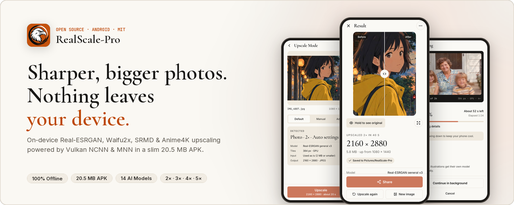
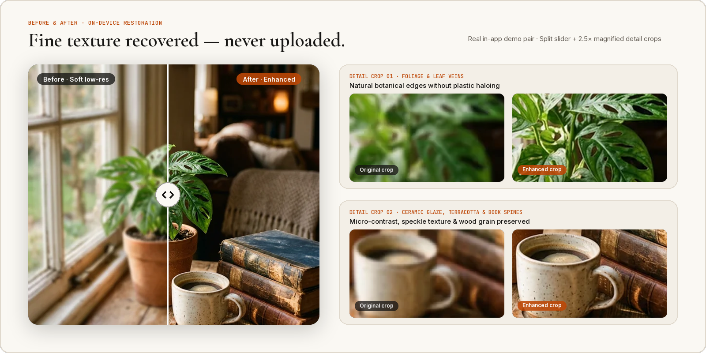
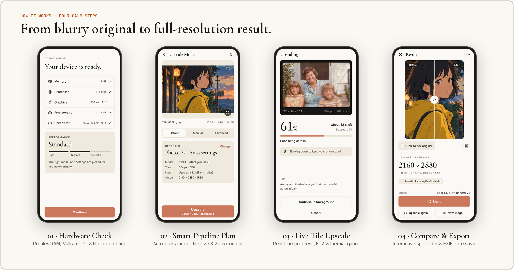
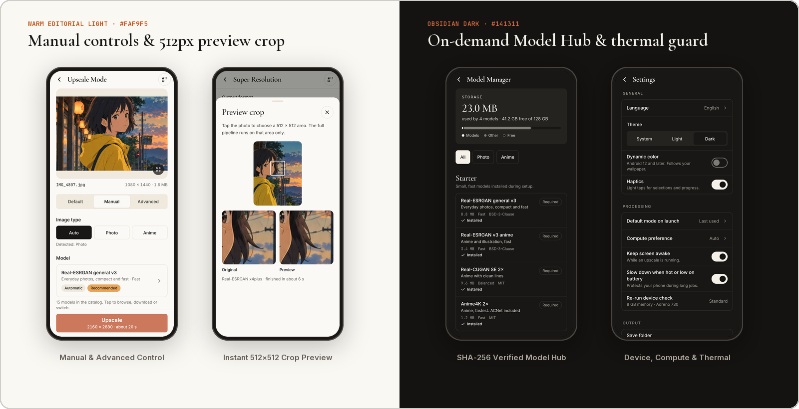

<!--
  RealScale-Pro (com.realscale.pro)：免费、开源、完全离线的 Android AI 图像超分辨率与画质增强应用。
  内置 Tencent ncnn (Vulkan) 与 Alibaba MNN 推理引擎，支持 Real-ESRGAN、RealSR DF2K、Remacri、UltraSharp、Waifu2x、SRMD、Anime4K。
-->

<p align="center">
  <picture>
    <source media="(prefers-color-scheme: dark)" srcset="assets/readme/hero-banner-dark.png" />
    <source media="(prefers-color-scheme: light)" srcset="assets/readme/hero-banner.png" />
    
  </picture>
</p>

<h1 align="center">RealScale-Pro</h1>

<p align="center">
  <b>免费、开源、100% 本地离线的 Android AI 图片超分辨率应用。</b><br />
  在手机端通过 Vulkan GPU 实现 2×–5× 照片修复与动漫无损放大 — 无需上传云端、无账号、无广告、无水印。
</p>

<p align="center">
  <a href="README.md">English</a> ·
  <a href="#下载与安装">下载 APK</a> ·
  <a href="#效果对比">效果对比</a> ·
  <a href="#使用指南">使用指南</a> ·
  <a href="#支持的-ai-模型">AI 模型 (14)</a> ·
  <a href="#从源码构建">源码构建</a> ·
  <a href="#致谢与开源协议">开源协议</a>
</p>

<p align="center">
  <a href="https://github.com/Rohitjjn/RealScale-Pro/releases/latest"></a>
  <a href="https://github.com/Rohitjjn/RealScale-Pro/actions/workflows/build-apk.yml"></a>
  <a href="LICENSE"></a>
  
  
</p>

---

**RealScale-Pro**（包名 `com.realscale.pro`）是一款基于 [`tumuyan/RealSR-NCNN-Android`](https://github.com/tumuyan/RealSR-NCNN-Android) 原生引擎生态、使用 Kotlin 与 Jetpack Compose 全新重构的 Android 离线图像超分辨率工具。

- **完全本地运行，零隐私泄露**：所有超分计算均在手机 GPU（Vulkan / OpenCL）或 CPU 上完成，模型下载后可完全断网使用，无任何统计埋点或云端上传。
- **20.5 MB 超精简安装包**：相比上游约 475 MB 的全量安装包体积缩减 95%。8 个原生 CLI 引擎通过 `binaries.tar.xz` 固实压缩内置，14 款 AI 模型支持按需下载、HTTP `Range` 断点续传与 SHA-256 完整性校验。
- **支持 2× / 3× / 4× / 5× 精准倍率**：神经网络以原生倍率推理后，自动结合 `resize-ncnn` Lanczos（`avir-lancir`）重采样输出精确目标分辨率。
- **硬件自适应与温控保护**：首次启动自动检测内存、CPU 核心与 Vulkan 性能分级，支持 `512×512` 局部快速预览、TTA（`-x`）增强、EXIF 信息保留、过热/低电量自动降载、系统“分享/打开方式”快捷浮窗与桌面小组件。

---

## 效果对比

<p align="center">
  
</p>

---

## 下载与安装

前往 [**GitHub Releases**](https://github.com/Rohitjjn/RealScale-Pro/releases/latest) 下载最新 `arm64-v8a` 签名版 APK：

- **最新版本 (`v2.3.1`)**：[`RealScale-Pro-v2.3.1-arm64.apk`](https://github.com/Rohitjjn/RealScale-Pro/releases/download/v2.3.1/RealScale-Pro-v2.3.1-arm64.apk)（`20.50 MiB`）
- **SHA-256 校验文件**：[`RealScale-Pro-v2.3.1-arm64.apk.sha256`](https://github.com/Rohitjjn/RealScale-Pro/releases/download/v2.3.1/RealScale-Pro-v2.3.1-arm64.apk.sha256)
- **Obtainium 自动更新**：在 Obtainium 中直接添加仓库地址 `https://github.com/Rohitjjn/RealScale-Pro` 即可追踪新版本。
- **系统要求**：Android 7.0+（API 24+）、64 位 `arm64-v8a` 处理器，推荐支持 Vulkan 1.1+ 的 GPU（无 Vulkan 时可切换 CPU 模式）。

---

## 使用指南

<p align="center">
  
</p>

1. **首次引导与入门模型包**：自动完成设备性能检测，并下载共 **7.9 MB** 的两款入门模型（*Real-ESRGAN General v3* 照片模型 + *Waifu2x Anime* 动漫插画模型）。
2. **导入图片**：支持首页 **相册（系统选图器）**、**文件（任意目录/SD 卡/网盘）**、**相机**，以及从任意图库/文件管理器通过 **分享** 或 **打开方式** 呼出快捷超分面板，或通过桌面小组件一键发起 `2× / 3× / 5×` 放大。
3. **模式与参数调节**：提供 **Upscale Mode**（日常快速）与 **Super Resolution Mode**（无压缩原图 + 33 MB 高精度模型），支持 **默认 / 手动 / 高级** 三档控制与 `512×512` 局部效果预览。
4. **对比与保存**：支持后台队列运行、分块实时显影、滑动前后对比、防 OOM 高清区域缩放查看，结果默认保存至 `Pictures/RealScale-Pro`（可自定义保存目录并保留 EXIF）。

<p align="center">
  
</p>

---

## 支持的 AI 模型

所有 14 款内置目录模型均托管于 [`huggingface.co/tumuyan2/realsr-models`](https://huggingface.co/tumuyan2/realsr-models)，下载时自动进行 SHA-256 校验：

- **入门模型（7.9 MB）**：Real-ESRGAN General v3（照片 4×）、Waifu2x Anime（动漫 2× + 降噪）
- **照片与修复**：Waifu2x Photo、SRMD（2×/3×/4× + 降噪）、RealSR DF2K、RealSR DF2K JPEG、Remacri x4、UltraMix Balanced x4、UltraSharp x4 (fp16)、Nomos8kSC x4
- **动漫与插画**：Waifu2x CUnet、AnimeSharp Lite x4、AnimeSharp x4、RealESRGAN Anime 6B (MNN)

完整模型说明与自定义 `.pth` / `.onnx` 转 NCNN/MNN 教程请参阅 [`docs/MODELS.md`](docs/MODELS.md)。

---

## 从源码构建

需要 JDK 21 与 Android SDK（已配置 `ANDROID_HOME`）：

```bash
git clone https://github.com/Rohitjjn/RealScale-Pro.git
cd RealScale-Pro
./scripts/prepare-engine-assets.sh
cd RealSR-NCNN-Android-GUI
./gradlew testDebugUnitTest assembleDebug assembleRelease
```

详细编译与签名说明请参阅 [`docs/BUILDING.md`](docs/BUILDING.md)，参与贡献请参阅 [`CONTRIBUTING.md`](CONTRIBUTING.md)。

---

## 致谢与开源协议

RealScale-Pro 基于 [**MIT License**](LICENSE) 开源，第三方组件与模型版权声明详见 [`THIRD_PARTY_NOTICES.md`](THIRD_PARTY_NOTICES.md)。衷心感谢 [tumuyan/RealSR-NCNN-Android](https://github.com/tumuyan/RealSR-NCNN-Android)、[nihui](https://github.com/nihui) / [Tencent ncnn](https://github.com/Tencent/ncnn)、[xinntao/Real-ESRGAN](https://github.com/xinntao/Real-ESRGAN)、[nagadomi/waifu2x](https://github.com/nagadomi/waifu2x)、[cszn/SRMD](https://github.com/cszn/SRMD)、[TianZerL/Anime4KCPP](https://github.com/TianZerL/Anime4KCPP)、[Alibaba MNN](https://github.com/alibaba/MNN) 与 [ImageMagick](https://github.com/ImageMagick/ImageMagick)。
